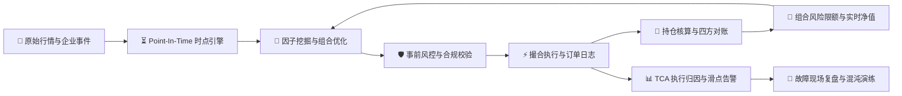

# 🐳 Quant Systems & Trading Research | AI 时代 7 天速通量化系统

<p align="center">
  <b>🌊 从摸鱼小白鲸到深海量化巨鲸 · 跨 45 家顶尖机构 · 21 类量化岗位 · AI 时代 7 天速通实战台</b><br>
  <i>"Don't spend 2 years reading theory. Master the real quant production pipeline in a 7-day deterministic sprint."</i>
</p>

<p align="center">
  
  
  
  
  
  
  
</p>

---

## 🧭 快速传送门 / Quick Navigation

- [🐳 为什么用 7 天就能速通量化核心？](#-为什么用-7-天就能速通量化核心)
- [🎣 核心硬核实证与避坑大赏](#-核心硬核实证与避坑大赏)
- [🌊 投研到撮合的深海全链路](#-投研到撮合的深海全链路)
- [🚀 大肥鱼 7 天速通作战表（每天 1.5 小时）](#-大肥鱼-7-天速通作战表每天-15-小时一步步通关)
- [🗺️ 21 类量化兵种作战地图与验收门禁](#️-21-类量化兵种作战地图与验收门禁)
- [⚡ 战备检查：1 分钟开箱复跑](#-战备检查1-分钟开箱复跑)
- [🌐 English Overview & 7-Day Sprint](#-english-overview--7-day-sprint)

---

## 🐳 为什么用 7 天就能速通量化核心？

过去学量化动辄半年起步，不是因为数学太难，而是**反馈闭环太慢 + 没人告诉你真实产线怎么踩坑**。

在 AI 时代（配合 `Claude 5.5` / `Gemini 4` / `GPT 6.1` 等前沿编程副驾），学习范式已经从“啃大部头教材”变成了**“可复现代码库 + 主动搞破坏触发报错 + AI 深度拷问”**。

本项目核查了 **45 家头部量化私募、外资做市商、公募对冲基金、券商与交易所**的真实公开岗位要求，收录 **76 条具名岗位与 41 条业务方向**，浓缩成 **26 项确定性代码实验**——**每天 1.5~2 小时，7 天打穿从行情 PIT、投研前推、多资产定价到撮合执行与 C++ 低延迟的完整闭环！**（如需逐岗长线精修，仓库内 `docs/08-role-curriculum.md` 同步提供 14 周扩展深化课表。）

---

## 🎣 核心硬核实证与避坑大赏

实验台所有代码均自带确定性复现测试（**26 项测试 100% 通过**，核心实验零第三方依赖，纯 Python 标准库即跑）：

| 实验模块 | 现实中的“翻车现场” | 🐳 本实验台的确定性解法与铁证 |
|:---|:---|:---|
| **期货换月价差 (M1)** | 以为换月能赚 120 块，直接拼接两个合约日线。 | 验证发现 **120.00 元**纯属跨期基差假象。必须在合约级台账中剥离基差与真实持仓增益。 |
| **做市微观损益 (M3)** | “我每笔都赚了 3 块钱盘口价差，怎么账面还亏了？” | 损益归因分解：捕获价差 **+3.00**，但库存逆向选择造成市值缩水叠加费率，最终净亏 **−3.10**。 |
| **PIT 盘口零泄露 (D1)** | 拿今天的收盘复权价回填上周的选股信号（未来信息穿越）。 | 时点版本化引擎：决策点仅可见当前时刻数据，历史修订严格按时点隔离（`缺失 -> 100 -> 80`）。 |
| **订单撤单竞态 (E1)** | 发出撤单指令就当做已经撤销，结果交易所已经撮合成交。 | 订单幂等日志状态机：委托 100 股，撤单竞态下前序成交 60 股，成功撤单 40 股，准确计量 **70 bp** 执行差额（IS），二次回放新增事件精准为 **0**。 |
| **前推 ETF 验证 (R1)** | 样本内过拟合，一到样本外就回撤腰斩。 | 2019–2025 年无未来数据自适应向前推演，年化 **13.25%**（最大回撤 **−35.16%**），超越固定 60 日动量（**9.85%**）。 |
| **C++ 亚纳秒价格档 (S1)** | 用 `std::map` 挂买卖五档，被高频穿透打成筛子。 | 连续数组平铺内存，p50 延迟达 **0.61 ns**，相比红黑树（**57.99 ns**）快了近 **95 倍**！ |

---

## 🌊 投研到撮合的深海全链路



---

## 🚀 大肥鱼 7 天速通作战表（每天 1.5 小时，一步步通关）

跟随这只硬核大肥鱼 🐳，用 **7 天高密度冲刺** 从海面直插量化核心腹地：

```
Day 1 🐟 浅滩摸底   -> 跑通 26 项测试 + 打开 catalog/index.html 锁定目标岗位主线
Day 2 🐋 投研防穿   -> 复跑 ETF 真实前推 (R1) + 模型漂移自动拒单 (R2)
Day 3 🎯 组合约束   -> 跑通受限二次规划优化 (P1)，算清换手摩擦与跟踪误差
Day 4 🌊 多资产博弈 -> 拆穿期货 120 元换月基差 (M1)、期权重估 (M2) 与做市 −3.10 元亏损 (M3)
Day 5 ⚡ 行情与撮合 -> 攻克 PIT 断流自愈 (D1)、撤单竞态 70bp 幂等回放 (E1) 与四方对账
Day 6 🚀 极速与运维 -> 编译实测 C++17 0.61ns 价格档 (S1) + SRE 故障演练与 AI 告警巡检
Day 7 🏆 鲸跃答辩   -> 把 evidence/*.json 喂给 AI 做 5 轮 Desk Head 压力拷问，产出简历级复盘
```

| 天数 | 冲刺主题 | 必跑命令 / 入口 | 当天验收成果（配合 AI 副驾） |
|:---|:---|:---|:---|
| **Day 1** | 行业全景与岗位定锚 | `python3 verify.py` · [`catalog/index.html`](catalog/index.html) | 跑通全部 26 项单测；从 45 家机构 21 类岗位里圈出最适合自己的 1~2 条主线 |
| **Day 2** | 投研前推与模型漂移 | `python3 -m lab.research` · `python3 -m lab.model_drift` | 故意制造未来函数观察测试变红，让 AI 讲透样本外漂移拒单机制 |
| **Day 3** | 组合优化与风控约束 | `python3 -m lab.portfolio_controls` | 对比受限与不受限组合权重差异，算清跟踪误差与双边换手成本 |
| **Day 4** | 期货、期权与做市微观 | `python3 -m lab.multi_asset` · `python3 -m lab.valuation` | 剥离 120 元期货换月假利润；手拆做市 +3.00 价差却净亏 −3.10 的微观账本 |
| **Day 5** | PIT 数据、执行与对账 | `python3 -m lab.data_plane` · `python3 -m lab.execution` | 演练盘口缺序号熔断与快照恢复；连续运行两次回放验证幂等性（新增事件=0） |
| **Day 6** | 纳秒级 C++ 与 AI 巡检 | `python3 verify.py --market-data --cpp` · [`docs/04`](docs/04-systems-and-operations.md) | 实测连续数组 0.61 ns vs `std::map` 57.99 ns；设计确定性接口隔离下的 AI 运维诊断 |
| **Day 7** | 模拟拷问与结项输出 | [`docs/10-capstone.md`](docs/10-capstone.md) · [`evidence/`](evidence/) | 把机器日志 JSON 喂给 `Claude 5.5` / `GPT 6.1` 模拟交易台主管 5 轮深挖，沉淀个人技术复盘 |

> 💡 **进阶深化**：7 天速通建立完整系统观后，可按 [`docs/08-role-curriculum.md`](docs/08-role-curriculum.md) 的 **14 周逐岗精修表**，针对目标岗位做深做透。

---

## 🗺️ 21 类量化兵种作战地图与验收门禁

| 岗位族 | 代表岗位 | 核心武器库 | 生产验收门禁 |
|:---|:---|:---|:---|
| **QR** | 量化策略研究员 | Python, NumPy, Pandas | 严禁未来信息渗透，通过时间外样本自适应检验 |
| **ML** | 金融机器学习 | PyTorch, LightGBM | 特征漂移自动告警，超越 Zero-Forecast 朴素基线 |
| **QD** | 量化开发工程师 | Python, C++, Cython | 投研回测与实盘仿真 100% 逐笔双轨对账 |
| **DATA** | 数据与时序工程师 | SQL, Parquet, Kdb+/q | 断流丢包自动恢复，Point-In-Time 严格版本化 |
| **PORT** | 组合管理与风险控制 | 凸优化求解器, CVXPY | 行业与风格敞口精准约束，控制跟踪误差与换手摩擦 |
| **INDEX** | 指数与 ETF 套利 | ETF 申赎清单, IOPV | 实时精准折溢价测算，全收益与价格指数无缝对齐 |
| **TRADE** | 量化执行与交易员 | TWAP, VWAP, FIX 协议 | 撤单并发竞态无死锁，执行差额（IS）精准归因 |
| **MICRO** | 做市与高频微观结构 | L2 深度, 队列动力学 | 剥离库存逆向选择亏损，精准评估纯价差捕获能力 |
| **FICC** | 期货、利率与外汇 | 期限结构, 曲线模型 | 跨期换月跳空剥离，DV01 利率敏感度精准对冲 |
| **DERIV** | 衍生品与波动率分析 | Black-Scholes, PDE | 校验平价公式，波动率曲面反解与非线性重估 |
| **SYS** | 低延迟基础设施 | C++17, 无锁队列, 内存预分配 | 亚纳秒级盘口更新，确定性延迟与零内存碎片 |
| **HW** | FPGA 硬件工程师 | Verilog/VHDL, PCIe DMA | 软硬件 Golden Vectors 对齐，回压零溢出 |
| **OPS** | 生产工程与 SRE | Prometheus, Linux Profiling | 确定性断点续传、无损回放与高可用切换 |
| **POST** | 清算结算与基金会计 | 关系型事务库, 记账引擎 | 四方对账零差错，单位净值穿透资金血缘 |
| **AI** | 量化智能化应用 | LLM Agent, 语义检索 | 确定性接口隔离，提供高可信日志诊断与决策辅助 |

---

## ⚡ 战备检查：1 分钟开箱复跑

核心实验纯标准库实现，克隆即可开箱复跑！

```bash
# 1. 克隆代码仓库
git clone https://github.com/jakelihua/quant-systems-industry.git
cd quant-systems-industry

# 2. 跑通 26 项确定性单元测试（0 报错、0 警告）
python3 -m unittest discover -s tests -v

# 3. 运行全链路实验台校验
python3 verify.py

# 4. 选跑 C++ 价格档极速基准（需 clang++ 或 g++）
python3 verify.py --market-data --cpp
```

---

## 🌐 English Overview & 7-Day Sprint

### What is this?
An open-source, reproducible **7-Day Quant Systems Fast-Track** (with an optional 14-week deep-dive syllabus) covering **21 distinct quantitative roles** audited across **45 top-tier financial firms**. Built for the AI-assisted engineering era: learn by breaking and fixing deterministic labs rather than passively reading textbooks.

### 7-Day Sprint Plan
- **Day 1**: Run `verify.py` (26 passing tests) & filter target tracks via `catalog/index.html`.
- **Day 2**: Walk-forward ETF validation (`R1`: 13.25% CAGR) & feature drift rejection (`R2`).
- **Day 3**: Constrained portfolio optimization (`P1`) & turnover friction accounting.
- **Day 4**: Futures 120.00 roll gap isolation (`M1`), options stress repricing (`M2`), market making −3.10 PnL breakdown (`M3`).
- **Day 5**: Point-in-time feed recovery (`D1`), idempotent cancel-race execution replay (`E1`, 70 bps IS) & 4-way reconciliation.
- **Day 6**: C++17 flat array vs `std::map` sub-nanosecond benchmark (`S1`: 0.61 ns vs 57.99 ns) & SRE/AI ops drills.
- **Day 7**: AI Desk-Head code review over `evidence/*.json` & production-grade capstone write-up.

```bash
git clone https://github.com/jakelihua/quant-systems-industry.git
cd quant-systems-industry
python3 verify.py
```

---

<p align="center">
  <b>🌟 如果这套 7 天速通实验台帮到了你，欢迎点个 Star 鼓励一下这只大肥鱼！🐳</b><br>
  <i>Empirically tested. Industrially verified. Dive deep and trade safe!</i>
</p>
