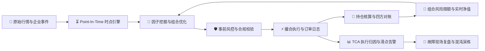

# 🐳 Quant Systems & Trading Research | AI 时代 7 天速通量化系统

<p align="center">
  <b>🌊 从摸鱼小白鲸到深海量化巨鲸 · 跨 45 家顶尖机构 · 21 类量化岗位 · AI 时代 7 天速通实战台</b><br>
  <i>"Don't spend 2 years reading theory. Master the real quant production pipeline in a 7-day deterministic sprint."</i>
</p>

<p align="center">
  
  
  
  
  
  
  
</p>

---

## 🧭 快速传送门 / Quick Navigation

> 📖 **零基础新手必读**：看不懂 PIT、TCA、IS、DV01、逆向选择这些黑话？先花 5 分钟看完这篇 **[《🐳 零基础大白话入门：把量化全链路黑话全部翻译成人话》](docs/00-plain-language-guide.md)**，用“开超市 / 点外卖 / 考试作弊”的日常比喻秒懂全部流程！

- [🐳 为什么用 7 天就能速通量化核心？](#-为什么用-7-天就能速通量化核心)
- [🎣 核心硬核实证与避坑大赏](#-核心硬核实证与避坑大赏)
- [🌊 投研到撮合的深海全链路](#-投研到撮合的深海全链路)
- [🚀 大肥鱼 7 天速通作战表（每天 1.5 小时）](#-大肥鱼-7-天速通作战表每天-15-小时一步步通关)
- [🗺️ 21 类量化兵种作战地图与验收门禁](#️-21-类量化兵种作战地图与验收门禁)
- [⚡ 战备检查：1 分钟开箱复跑](#-战备检查1-分钟开箱复跑)
- [🌐 English Overview & 7-Day Sprint](#-english-overview--7-day-sprint)

---

## 🐳 先回答第一个疑问：量化到底分为哪些？怎么学最快？

很多金融或技术同学点进来第一个问题就是：**“量化到底分为哪些？”**
按**赚什么钱（策略大类）**看，整个行业主要是 5 大战场：
1. **股票多头 / 指数增强（指增）**：对标沪深 300 / 中证 500 等指数，靠量价、基本面与机器学习因子赚超额 Alpha。
2. **市场中性 / 量化对冲**：做多一篮子股票 + 做空股指期货对冲大盘波动，赚剥离大盘后的纯超额。
3. **CTA（商品期货趋势/套利）**：在商品和股指期货上做趋势跟踪、跨期/跨品种套利。
4. **高频做市 & 统计套利（HFT / Market Making）**：拼极速系统与微观盘口，赚买卖价差与 ETF 折溢价套利。
5. **衍生品与波动率交易**：围绕期权定价、波动率曲面和非线性对冲做交易。

**怎么学最快？一句话：别一开始背一堆教材，要「干中学」——先动手跑真实案例，遇到一个具体疑问，马上借助 AI（`Claude 5.5` / `Gemini 4` / `GPT 6.1`）和代码把它解决掉，解决完自然就学会了。**

过去学量化动辄半年起步，不是因为数学太难，而是**反馈闭环太慢 + 没人告诉你真实产线怎么踩坑**。

在 AI 时代（配合 `Claude 5.5` / `Gemini 4` / `GPT 6.1` 等前沿编程副驾），学习范式已经从“啃大部头教材”变成了**“可复现代码库 + 主动搞破坏触发报错 + AI 深度拷问”**。

本项目核查了 **45 家头部量化私募、外资做市商、公募对冲基金、券商与交易所**的真实公开岗位要求，收录 **76 条具名岗位与 41 条业务方向**，浓缩成 **26 项确定性代码实验**——**每天 1.5~2 小时，7 天打穿从行情 PIT、投研前推、多资产定价到撮合执行与 C++ 低延迟的完整闭环！**（如需逐岗长线精修，仓库内 `docs/08-role-curriculum.md` 同步提供 14 周扩展深化课表。）

---

## 🎣 核心硬核实证与避坑大赏

实验台所有代码均自带确定性复现测试（**26 项测试 100% 通过**，核心实验零第三方依赖，纯 Python 标准库即跑）：

| 实验模块 | 现实中的“翻车现场” | 🐳 本实验台的确定性解法与铁证 |
|:---|:---|:---|
| **期货换月价差 (M1)** | 以为换月能赚 120 块，直接拼接两个合约日线。 | 验证发现 **120.00 元**纯属跨期基差假象。必须在合约级台账中剥离基差与真实持仓增益。 |
| **做市微观损益 (M3)** | “我每笔都赚了 3 块钱盘口价差，怎么账面还亏了？” | 损益归因分解：捕获价差 **+3.00**，但库存逆向选择造成市值缩水叠加费率，最终净亏 **−3.10**。 |
| **PIT 盘口零泄露 (D1)** | 拿今天的收盘复权价回填上周的选股信号（未来信息穿越）。 | 时点版本化引擎：决策点仅可见当前时刻数据，历史修订严格按时点隔离（`缺失 -> 100 -> 80`）。 |
| **订单撤单竞态 (E1)** | 发出撤单指令就当做已经撤销，结果交易所已经撮合成交。 | 订单幂等日志状态机：委托 100 股，撤单竞态下前序成交 60 股，成功撤单 40 股，准确计量 **70 bp** 执行差额（IS），二次回放新增事件精准为 **0**。 |
| **前推 ETF 验证 (R1)** | 样本内过拟合，一到样本外就回撤腰斩。 | 2019–2025 年无未来数据自适应向前推演，年化 **13.25%**（最大回撤 **−35.16%**），超越固定 60 日动量（**9.85%**）。 |
| **C++ 亚纳秒价格档 (S1)** | 用 `std::map` 挂买卖五档，被高频穿透打成筛子。 | 连续数组平铺内存，p50 延迟达 **0.61 ns**，相比红黑树（**57.99 ns**）快了近 **95 倍**！ |

---

## 🌊 投研到撮合的深海全链路（附大白话翻译）



**🗣️ 把上面 6 个环节翻译成人话（想象你在经营一家全自动智能生鲜超市）：**
1. **📡 原始行情** = 交易所每秒发来的“当前菜价单 + 排队买菜人数”。
2. **⏳ Point-In-Time (PIT) 时点引擎** = **“不准偷看明天的报纸”**，回测时严格封存当时人类已知的数据，杜绝拿未来价格作弊。
3. **🧠 因子与组合优化** = 挑出可能涨的品种，并决定每个品种买几成仓、不把鸡蛋放同一个篮子（戴着风险镣铐分配资金）。
4. **🛡️ 事前风控** = 出门前的保命安检：查兜里钱够不够、防手抖多打两个零、防自己跟自己成交。
5. **⚡ 撮合执行与订单日志** = 把大单拆小单悄悄买防抬价，同时把每笔“下单/成交/撤单”按顺序记死，崩了重启也能原样还原（幂等）。
6. **💼 四方对账与复盘** = 每天收盘把“自己记的账”和“券商/交易所账单”逐笔画勾，少一分钱立刻报警查原因。

> 更多黑话对照表（前推验证、最大回撤、期货基差、做市逆向选择、70 bp 滑点、DV01、Cache Miss 等）请直接查阅 👉 **[零基础大白话词典](docs/00-plain-language-guide.md)**。

---

## 🚀 大肥鱼 7 天案例驱动通关法（每天吃透 1 个真实案例）

> **核心学习心法**：别去背书，也别试图一口气看完所有文档。本仓库强制采用 **「1 天 = 1 个真实案例 → 彻底理解知识点 → 自己动手改代码实践 → 过关再进下一个」** 的节奏。
>
> **一定要充分利用 AI 去学**：每个案例遇到看不懂的公式、报错或数字，直接把对应的源码和 `evidence/*.json` 丢给 `Claude 5.5` / `Gemini 4` / `GPT 6.1`，让 AI 用大白话给你拆解线上事故、出边界测试题、模拟面试官拷问你。
>
> **诚实提醒**：7 天案例通关只是帮你推开大门、建立正确的工程骨架；**真正学完这 7 个案例之后，后面才是漫长而扎实的工作实践操作**（真实盘口、实盘风控、故障值班与长线精修）。

| 节奏 | 当天真实案例 | 先彻底理解的知识点（大白话） | 自己动手实践（跑完再进下一天） | 配合 AI 怎么吃透？ |
|:---|:---|:---|:---|:---|
| **Day 1 · Case 1** | **45 家大厂真实岗位案例** | 搞懂大厂招的 21 类人分别卡在交易流水线哪一环，不盲目全栈 | 读[大白话词典](docs/00-plain-language-guide.md)，跑通 `python3 verify.py`，打开 [`catalog/index.html`](catalog/index.html) 筛选目标岗位 | 把你现有简历和筛出的 3 个 JD 喂给 AI，让它画出最省时间的个人切入路线 |
| **Day 2 · Case 2** | **ETF 真实日线前推 & 模型失效案例** | 什么是未来函数、为什么前推年化 13.25% 却有 −35.16% 回撤、特征漂移怎么自动拒单 | 跑 `python3 -m lab.research` 与 `lab.model_drift`；**亲手删一行日期隔离代码**看单测如何立刻变红 | 把报错堆栈丢给 AI，让它讲透“未来函数上线实盘会怎么亏钱” |
| **Day 3 · Case 3** | **指数增强组合受限优化案例** | 为什么不能梭哈单只股票、跟踪误差（偏离大盘程度）和频繁换手的手续费怎么算 | 跑 `python3 -m lab.portfolio_controls`；**动手调大/调小单票仓位和换手上限**，对比收益变化 | 让 AI 结合输出 JSON，给你讲清“为什么纸面收益降了，但实盘反而更安全” |
| **Day 4 · Case 4** | **期货换月假利润 & 做市商亏损案例** | 换月为什么会凭空多出 120 元空气价差；做市商每笔赚 +3.00 价差为何最后净亏 −3.10 | 跑 `python3 -m lab.multi_asset` 与 `lab.valuation`；**亲手手算一遍 120 元基差和 −3.10 元账本** | 让 AI 给你出 2 道期权平价和做市库存倾斜的变体题，自己写代码验算 |
| **Day 5 · Case 5** | **行情断流自愈 & 撤单并发竞态案例** | 历史修订怎么做到 `缺失→100→80` 零穿越；外卖取消前骑手已敲门（成交 60 撤 40、70 bp 差额）与幂等回放 | 跑 `python3 -m lab.data_plane`，再**连续跑两次** `python3 -m lab.execution` 亲眼确认第二次新增事件为 `0` | 让 AI 模拟“丢包 + 重复回报同时发生”的故障场景，自己补一条单测防住它 |
| **Day 6 · Case 6** | **C++17 盘口延迟爆炸 & AI 巡检案例** | 连续数组紧挨书架（0.61 ns）为何比红黑树藏宝图（57.99 ns）快约 95 倍；AI 运维为何只能查日志不能碰发单按钮 | 编译跑通 `python3 verify.py --market-data --cpp`，精读 [`docs/04-systems-and-operations.md`](docs/04-systems-and-operations.md) | 让 AI 逐行解释 `benchmarks/price_levels.cpp` 的内存局部性与 CPU L1 Cache 命中原理 |
| **Day 7 · Case 7** | **交易台主管审计复盘案例** | 把前 6 天的零散代码串成完整工业流水线，做到能画图、能讲透、能扛住代码级追问 | 选 1 个 [`docs/10-capstone.md`](docs/10-capstone.md) 结项任务，整理出自己的实验日志与复盘文档 | 把 `evidence/*.json` 喂给 AI 扮演 Desk Head 发起 5 轮苛刻 Code Review 拷问 |

> 🌱 **7 天之后怎么走？** 跑完这 7 个案例只是推开了量化工程的大门，真正的成长在后面**漫长的真实工作实践操作**中。你可以结合 [`docs/08-role-curriculum.md`](docs/08-role-curriculum.md) 的 14 周逐岗深化课表，在真实项目、开源贡献和一线工作中持续打磨。

---

## 🗺️ 21 类量化兵种作战地图与验收门禁

| 岗位族 | 代表岗位 | 核心武器库 | 生产验收门禁 |
|:---|:---|:---|:---|
| **QR** | 量化策略研究员 | Python, NumPy, Pandas | 严禁未来信息渗透，通过时间外样本自适应检验 |
| **ML** | 金融机器学习 | PyTorch, LightGBM | 特征漂移自动告警，超越 Zero-Forecast 朴素基线 |
| **QD** | 量化开发工程师 | Python, C++, Cython | 投研回测与实盘仿真 100% 逐笔双轨对账 |
| **DATA** | 数据与时序工程师 | SQL, Parquet, Kdb+/q | 断流丢包自动恢复，Point-In-Time 严格版本化 |
| **PORT** | 组合管理与风险控制 | 凸优化求解器, CVXPY | 行业与风格敞口精准约束，控制跟踪误差与换手摩擦 |
| **INDEX** | 指数与 ETF 套利 | ETF 申赎清单, IOPV | 实时精准折溢价测算，全收益与价格指数无缝对齐 |
| **TRADE** | 量化执行与交易员 | TWAP, VWAP, FIX 协议 | 撤单并发竞态无死锁，执行差额（IS）精准归因 |
| **MICRO** | 做市与高频微观结构 | L2 深度, 队列动力学 | 剥离库存逆向选择亏损，精准评估纯价差捕获能力 |
| **FICC** | 期货、利率与外汇 | 期限结构, 曲线模型 | 跨期换月跳空剥离，DV01 利率敏感度精准对冲 |
| **DERIV** | 衍生品与波动率分析 | Black-Scholes, PDE | 校验平价公式，波动率曲面反解与非线性重估 |
| **SYS** | 低延迟基础设施 | C++17, 无锁队列, 内存预分配 | 亚纳秒级盘口更新，确定性延迟与零内存碎片 |
| **HW** | FPGA 硬件工程师 | Verilog/VHDL, PCIe DMA | 软硬件 Golden Vectors 对齐，回压零溢出 |
| **OPS** | 生产工程与 SRE | Prometheus, Linux Profiling | 确定性断点续传、无损回放与高可用切换 |
| **POST** | 清算结算与基金会计 | 关系型事务库, 记账引擎 | 四方对账零差错，单位净值穿透资金血缘 |
| **AI** | 量化智能化应用 | LLM Agent, 语义检索 | 确定性接口隔离，提供高可信日志诊断与决策辅助 |

---

## 🏟️ 7 天之后去哪练手？实战平台梯队地图

跑完本仓库的 7 个案例推开大门后，后面就是**漫长而扎实的真实工作实践操作**。按你的主攻方向，挑 1~2 个免费或低门槛平台接着真刀真枪练：

| 实战方向 | 推荐练手平台 / 工具 | 核心用途与避坑提醒 |
|:---|:---|:---|
| **A 股选股 / ETF 模拟盘** | **聚宽 (JoinQuant)** · **米筐 (RiceQuant)** · **掘金量化 (MyQuant)** | 自带洗好的 A 股日线/分钟线与财报数据，免费跑全市场回测与模拟盘。注意手动调高滑点，防止被框架默认假设误导。 |
| **全球因子挖掘 & 简历背书** | **WorldQuant BRAIN（世坤）** · **QuantConnect** | **WorldQuant BRAIN** 完全免费写横截面 Alpha，做出高夏普因子可拿官方认证，一线大厂面试普遍认可；QuantConnect 适合练美股与期权链。 |
| **期货 CTP 真实撮合仿真** | **SimNow（上期技术官方仿真）** + **vn.py (VeighNa)** | 完全免费！直连真实 CTP 仿真柜台，演练期货换月、盯市、夜盘断线重连与撤单竞态（`QD/SYS/TRADE` 必练）。 |
| **高频 L2 盘口 & 低延迟沙箱** | **Binance Testnet（测试网假币）** · **券商 MiniQMT / Ptrade** | 测试网免费提供真实 **L2 WebSocket 逐笔盘口流**，非常适合用 C++/Python 练订单簿重构与做市模拟（纯技术沙箱，勿碰真钱高杠杆）；A 股实盘可用券商 MiniQMT/Ptrade。 |
| **本地开源投研“造轮子”** | **AKShare / Tushare** + **微软 Qlib** | 免费拉取公开行情，配合微软 Qlib 演练 LightGBM / 深度学习金融时序预测（`ML/QR` 方向）。 |

---

## ⚡ 战备检查：1 分钟开箱复跑

核心实验纯标准库实现，克隆即可开箱复跑！

```bash
# 1. 克隆代码仓库
git clone https://github.com/jakelihua/quant-systems-industry.git
cd quant-systems-industry

# 2. 跑通 26 项确定性单元测试（0 报错、0 警告）
python3 -m unittest discover -s tests -v

# 3. 运行全链路实验台校验
python3 verify.py

# 4. 选跑 C++ 价格档极速基准（需 clang++ 或 g++）
python3 verify.py --market-data --cpp
```

---

## 🌐 English Overview & 7-Day Sprint

### What is this?
An open-source, reproducible **7-Day Quant Systems Fast-Track** (with an optional 14-week deep-dive syllabus) covering **21 distinct quantitative roles** audited across **45 top-tier financial firms**. Built for the AI-assisted engineering era: learn by breaking and fixing deterministic labs rather than passively reading textbooks.

### 7-Day Sprint Plan
- **Day 1**: Run `verify.py` (26 passing tests) & filter target tracks via `catalog/index.html`.
- **Day 2**: Walk-forward ETF validation (`R1`: 13.25% CAGR) & feature drift rejection (`R2`).
- **Day 3**: Constrained portfolio optimization (`P1`) & turnover friction accounting.
- **Day 4**: Futures 120.00 roll gap isolation (`M1`), options stress repricing (`M2`), market making −3.10 PnL breakdown (`M3`).
- **Day 5**: Point-in-time feed recovery (`D1`), idempotent cancel-race execution replay (`E1`, 70 bps IS) & 4-way reconciliation.
- **Day 6**: C++17 flat array vs `std::map` sub-nanosecond benchmark (`S1`: 0.61 ns vs 57.99 ns) & SRE/AI ops drills.
- **Day 7**: AI Desk-Head code review over `evidence/*.json` & production-grade capstone write-up.

```bash
git clone https://github.com/jakelihua/quant-systems-industry.git
cd quant-systems-industry
python3 verify.py
```

---

<p align="center">
  <b>🌟 如果这套 7 天速通实验台帮到了你，欢迎点个 Star 鼓励一下这只大肥鱼！🐳</b><br>
  <i>Empirically tested. Industrially verified. Dive deep and trade safe!</i>
</p>
