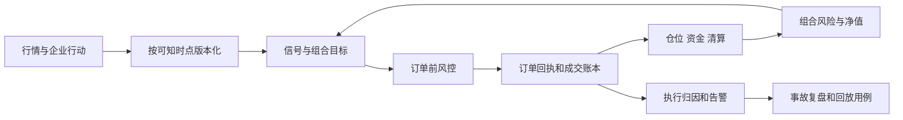

# 高阶量化系统与交易研究

用一个可复验的研究项目串起投研、行情、执行、订单账本、风险和运维。课程以九坤智能化工程师为主线，比较九坤同轮量化岗位及其他机构的直接招聘资料。扩展版从 45 家机构的公开资料抽取 76 条具名岗位与 41 条岗位方向，按 21 类岗位组织为 14 周课程。每条记录均可追溯到原来源。默认先读岗位目录与盘口手册，再用实验复核结论。

| 模块 | 用来解决的问题 | 入口 |
|---|---|---|
| 跨机构岗位目录 | 每家机构有哪些可核对岗位及招聘方向 | [逐机构证据表](catalog/jd-catalog.md) · [调研口径](docs/07-survey-method.md) |
| 21 类岗位课程 | 岗位日常产出、技术选型和实践验收 | [课程地图](docs/08-role-curriculum.md) |
| 实验与结项 | 期货、期权、做市、风控、对账等已完成实验 | [实验逐项复算](docs/09-experiment-log.md) · [结项与评分](docs/10-capstone.md) |
| 岗位和架构 | JD 中的技术属于哪一段链路，为什么用它，有什么替代方案 | [岗位调研与技术选型](docs/01-jd-and-stack.md) |
| 看盘和交易 | 如何读股票、ETF、期货、期权、指数增强、做市和执行盘 | [量化看盘手册](docs/02-desk-guide.md) |
| 研究与风险 | 如何做时间外验证、成本分析、组合约束、归因和尾部风险 | [研究与风控](docs/03-research-and-risk.md) |
| 系统与运维 | 如何处理盘口乱序、修订数据、撤单竞态、对账和 AI 辅助诊断 | [系统实验与运行手册](docs/04-systems-and-operations.md) |
| 学习记录 | 如何完成十周训练、验证个人掌握程度、沉淀面试和写作素材 | [学习记录与训练路线](docs/05-learning-log.md) |
| 引用 | 机构原始招聘材料、交易所资料、技术文档和论文 | [来源与证据边界](docs/06-sources.md) |

## 复跑

Python 3.9+，核心实验仅使用标准库，从仓库根目录运行：

```bash
python3 -m unittest discover -s tests -v
python3 -m lab.data_plane
python3 -m lab.execution
python3 -m lab.execution
```

第二次订单回放应新增 0 条事件。也可以从项目根目录按总入口运行：
```bash
python3 verify.py
python3 verify.py --market-data --cpp
```

第一个命令验证目录与合成实验。第二个命令需要离线包固定行情及 C++17 编译器，并加跑全部回测和价格档基准。按模块调用真实行情实验也可以：

```bash
python3 baseline/run.py
python3 -m lab.research
```

输出位于 `out/` 和 `baseline/results/`。Git 版本跟踪代码、合成夹具、文档和聚合证据。腾讯行情和抽样响应独立放在离线包的 `baseline/data/`，对应 SHA-256 见 [快照证据](evidence/input-provenance.json)。

## 研究与工程证据

- [前推实验](evidence/research.json)。2019–2025 年前推选择年化 **13.25%**，同期固定 60 日轮动 **9.85%**，同池等权 **14.61%**。前推选择的最大回撤 **−35.16%**。七个前推年度都选 20 日窗口。
- [订单回放](evidence/execution.json)。合成订单在撤单确认前继续成交。委托 100 股，累计成交 60 股，余下 40 股撤掉，模拟执行差额为 **70 bp**。
- [盘口与可知数据](evidence/data-plane.json)。缺序号时暂停输出盘口，恢复快照后重新发布。按决策可知时间查询所得修订值依次为 **缺失、100、80**。
- [回放重跑](evidence/execution-replay.json)。重复投递得到相同账本，新增事件为零。
- [多资产实验](evidence/multi-asset.json)、[约束组合与对账](evidence/portfolio-controls.json)、[模型漂移](evidence/model-drift.json)、[估值与资金流](evidence/valuation.json)、[C++ 基准](evidence/price-levels.json) 对应[实验笔记](docs/09-experiment-log.md)。

## 研究到交易的系统链路



真实市场实验是 ETF 日线历史模拟。合成实验用于执行、行情和风控协议验证。课程中的期货、期权、做市和实盘基础设施有桌面案例与验收任务。
