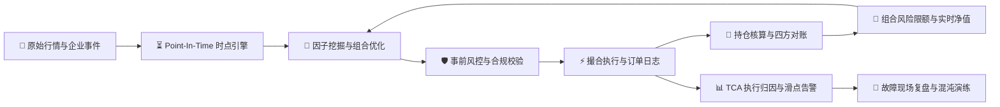

# 🐳 Quant Systems & Trading Research | 量化系统与交易研究实验台

<p align="center">
  <b>🌊 跨 45 家机构 · 21 类量化岗位 · 7 天案例实验练习 + 14 周逐岗深化路线</b><br>
  <i>"Verify every number from first principles: separate roll gaps, trace cancel races, and audit every fill."</i>
</p>

<p align="center">
  
  
  
  
  
  
</p>

---

## 🧭 快速传送门 / Quick Navigation

> 📖 **零基础新手必读**：看不懂 PIT、IS、DV01、Markout 这些名词？先花 5 分钟看 **[《🐳 零基础大白话入门词典》](docs/00-plain-language-guide.md)**，每个术语都对应到具体代码文件。

- [🐳 先看一笔账：量化到底分为哪些？怎么学？](#-先看一笔账量化到底分为哪些怎么学)
- [🎣 核心可复算实验证据（严格对齐 evidence/*.json）](#-核心可复算实验证据严格对齐-evidencejson)
- [🌊 投研到撮合的系统链路（附大白话翻译）](#-投研到撮合的系统链路附大白话翻译)
- [🚀 7 天案例实验练习（每天吃透 1 个案例）](#-7-天案例实验练习每天吃透-1-个案例)
- [🏟️ 实践之后去哪练手？实战平台梯队地图](#️-实践之后去哪练手实战平台梯队地图)
- [⚡ 复跑指南：公开仓库 vs 完整数据包两条路径](#-复跑指南公开仓库-vs-完整数据包两条路径)

---

## 🐳 先看一笔账：量化到底分为哪些？怎么学？

同一组期货合成行情，把近月和远月直接拼起来，账上显示赚了 **280 元**。按实际持有的合约逐日结算，毛损益只有 **160 元**，扣掉 12 元费用后是 **148 元**。差出来的 **120 元**，来自换月时两份合约 6 个点的价格差。

沿着这笔账往下查，就会遇到量化团队每天要处理的问题：数据什么时候可以用，仓位怎么变，订单什么时候算成交，最后谁来把账对上。

本仓库核查了 **45 家机构**、**56 个公开来源**，整理出 **76 条具名岗位**与 **41 条岗位方向**，按 **21 类量化岗位**组织。按策略大类看，行业主要是 5 大方向：
1. **股票多头 / 指数增强（指增）**：对标宽基指数，靠量价、基本面与机器学习因子赚超额 Alpha。
2. **市场中性 / 量化对冲**：做多一篮子股票 + 做空股指期货对冲大盘波动。
3. **CTA（商品期货趋势/套利）**：在商品和股指期货上做趋势跟踪、跨期/跨品种套利。
4. **高频做市 & 统计套利**：依赖低延迟系统与微观盘口管理，捕获买卖价差与折溢价。
5. **衍生品与波动率交易**：围绕期权定价、波动率曲面和非线性压力重估。

**学习方法**：不要一开始先背一堆教材，而是**「干中学」**——每天跑通并拆解 1 个真实实验案例，遇到问题直接借助 AI（`Claude 5.5` / `Gemini 4` / `GPT 6.1`）和源码把账算明白。**7 天用于完成核心实验练习，14 周用于逐岗深化（[`docs/08-role-curriculum.md`](docs/08-role-curriculum.md)），学完之后则是漫长的真实工作实践操作。**

---

## 🎣 核心可复算实验证据（严格对齐 `evidence/*.json`）

| 实验模块 | 数据口径 | 精确可复算结论（与 `evidence/` 一致） | 证据文件 |
|:---|:---|:---|:---|
| **期货换月 (M1)** | 合成数据 | 直接拼接显示盈利 **280 元**；按合约逐日结算毛损益 **160 元**，扣费 12 元后净损益 **148 元**，差额 **120 元**为换月价差。 | [`multi-asset.json`](evidence/multi-asset.json) |
| **做市损益 (M3)** | 合成数据 | **4 笔成交合计**捕获价差 **+3.00 元**，但收盘市场中价变动 **−5.80 元**、费用 **−0.30 元**，最终净损益 **−3.10 元**（期末持仓 100 股）。 | [`multi-asset.json`](evidence/multi-asset.json) |
| **PIT 与断流 (D1)** | 合成数据 | 盘口缺序号时暂停报价，快照恢复后重新发布；历史修订按决策可知时点查询依次为 **`None` → `100` → `80`**。 | [`data-plane.json`](evidence/data-plane.json) |
| **撤单竞态 (E1)** | 合成数据 | 委托 100 股：**40 股在发撤单前成交**，**20 股在撤单请求发出与确认返回之间成交**，余下 40 股撤掉；执行差额（IS）**70 bp**；二次回放新增事件为 **0**。 | [`execution.json`](evidence/execution.json) |
| **ETF 前推 (R1)** | 真实历史日线（离线包） | 2019–2025 向前推演年化 **13.25%**（最大回撤 **−35.16%**），同期固定 60 日动量 **9.85%**，同池等权 **14.61%**。 | [`research.json`](evidence/research.json) |
| **C++ 价格档 (S1)** | 4096 档合成基准 | 批内平均每次更新耗时 p50：连续数组留档 **1.10 ns** vs `std::map` **64.71 ns**（仅说明稠密档位更新中连续内存更优，实盘表现受多因素影响）。 | [`price-levels.json`](evidence/price-levels.json) |

---

## 🌊 投研到撮合的系统链路（附大白话翻译）



**🗣️ 6 步大白话翻译**：
1. **原始行情**：交易所发来的实时报价与排队挂单信息。
2. **PIT 时点引擎**：不准偷看明天的报纸——每个决策点只能读到当时人类已知的数据。
3. **因子与组合优化**：挑品种并按行业/单票/换手约束分配仓位。
4. **事前风控**：发单前检查资金、价格偏离、自成交与熔断开关（Kill Switch）。
5. **撮合执行与订单日志**：记录每笔委托/成交/撤单，保证崩溃重放幂等（不重复记账）。
6. **四方对账与复盘**：本地账本与外部凭证逐笔核对，定位漏单、重复单与字段不一致。

---

## 🚀 7 天案例实验练习（每天吃透 1 个案例）

> 每天只死磕 1 个案例：**看懂问题 → 跑通代码 → 动手改坏看断言报错 → 借助 AI 讲透原理 → 过关再进下一个**。

| 练习日 | 当天真实案例 | 核心知识点 | 动手实践命令 |
|:---|:---|:---|:---|
| **Day 1** | 45 家机构岗位映射 | 21 类岗位在流水线的位置与技术栈 | 读[大白话词典](docs/00-plain-language-guide.md)，跑 `python3 verify.py`，打开 [`catalog/index.html`](catalog/index.html) |
| **Day 2** | 模型漂移与前推逻辑 | 样本外验证、特征均值漂移触发告警与拒单 | `python3 -m lab.model_drift`（有冻结行情可加跑 `lab.research`） |
| **Day 3** | 受限组合优化与对账 | 跟踪误差、换手成本与四方对账分类 | `python3 -m lab.portfolio_controls`（动手修改约束阈值重跑对比） |
| **Day 4** | 期货换月、期权与做市 | 280 vs 160/148 换月账本、期权全量重估、做市 4 笔 +3.00 / −5.80 / −0.30 分解 | `python3 -m lab.multi_asset` · `python3 -m lab.valuation` |
| **Day 5** | PIT 断流与撤单竞态 | 缺序号暂停报价、`None→100→80`、40+20 股撤单竞态、70 bp IS 与幂等回放 | `python3 -m lab.data_plane` · 连续跑两次 `python3 -m lab.execution` |
| **Day 6** | C++17 价格档与运维 | 稠密数组（1.10 ns）vs `std::map`（64.71 ns）基准、SRE 故障演练与 AI 巡检边界 | `python3 verify.py --cpp` · 精读 [`docs/04-systems-and-operations.md`](docs/04-systems-and-operations.md) |
| **Day 7** | 交易台审计复盘 | 用 `evidence/*.json` 串起完整流水线，接受 AI 模拟 Desk Head 5 轮追问 | 选 1 个 [`docs/10-capstone.md`](docs/10-capstone.md) 任务完成复盘 |

> 🌱 **长线深化**：完成 7 天核心实验练习后，可按 [`docs/08-role-curriculum.md`](docs/08-role-curriculum.md) 的 **14 周逐岗深化路线**持续推进，并进入真实工作实践。

---

## 🏟️ 实践之后去哪练手？实战平台梯队地图

| 实战方向 | 推荐练手平台 / 工具 | 核心用途与提醒 |
|:---|:---|:---|
| **A 股选股 / ETF 模拟盘** | **聚宽 (JoinQuant)** · **米筐 (RiceQuant)** · **掘金量化 (MyQuant)** | 自带 A 股行情与财报数据，免费跑回测与模拟盘；建议手动调高滑点。 |
| **全球因子挖掘 & 简历背书** | **WorldQuant BRAIN（世坤）** · **QuantConnect** | WorldQuant BRAIN 免费写横截面 Alpha；QuantConnect 适合练美股与期权链。 |
| **期货 CTP 真实撮合仿真** | **SimNow（上期技术官方仿真）** + **vn.py (VeighNa)** | 免费直连 CTP 仿真柜台，练期货换月、保证金与撤单竞态。 |
| **高频 L2 盘口 & 低延迟沙箱** | **Binance Testnet（测试网假币）** · **券商 MiniQMT / Ptrade** | 测试网免费提供 L2 WebSocket 逐笔流（纯技术沙箱，勿碰真钱高杠杆）；A 股实盘可用券商 MiniQMT/Ptrade。 |
| **本地开源投研“造轮子”** | **AKShare / Tushare** + **微软 Qlib** | 免费拉取公开行情，配合 Qlib 练机器学习金融时序预测。 |

---

## ⚡ 复跑指南：公开仓库 vs 完整数据包两条路径

Python 3.9+，核心实验仅依赖标准库。请根据你手头的数据情况选择对应命令：

### 路径一：公开 GitHub 仓库直接复跑（开箱即跑）
```bash
git clone https://github.com/jakelihua/quant-systems-industry.git
cd quant-systems-industry

# 1. 运行公开仓库默认验证：15 项测试通过，2 项（依赖离线冻结行情）自动跳过
python3 verify.py

# 2. 若本机装有 C++17 编译器（clang++ / g++），可加跑 C++ 价格档基准
python3 verify.py --cpp
```

### 路径二：带冻结历史行情的完整离线数据包复跑（26 项全量通过）
GitHub 公开仓库不直接托管第三方历史行情 JSON（原始哈希与来源见 [`evidence/input-provenance.json`](evidence/input-provenance.json)）。若已放入离线包的 `baseline/data/tencent_snapshot.json` 与 `eastmoney_510300_20251224_20251231.json`，可运行全量验证：

```bash
# 运行全部 26 项测试（17 项核心实验 + 9 项真实行情基线）+ C++ 基准
python3 verify.py --market-data --cpp
```

---

<p align="center">
  <b>🌟 如果这套可复算实验台对你有帮助，欢迎点个 Star！🐳</b><br>
  <i>Verify every number. Build real engineering intuition.</i>
</p>
