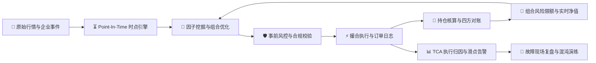

# 🐳 Quant Systems & Trading Research | 高阶量化系统与交易研究

<p align="center">
  <b>🌊 从摸鱼小白鲸到深海量化巨鲸 · 跨 45 家顶尖机构 · 21 类量化岗位 · 14 周硬核通关指南</b><br>
  <i>"Don't just backtest in fair weather. Dive into the deep trench where order books crack and spreads bleed."</i>
</p>

<p align="center">
  
  
  
  
  
  
  
</p>

---

## 🧭 快速传送门 / Quick Navigation

- [🐳 项目起源：告别空中楼阁](#-项目起源告别空中楼阁)
- [🎣 核心硬核实证与避坑大赏](#-核心硬核实证与避坑大赏)
- [🌊 投研到撮合的深海全链路](#-投研到撮合的深海全链路)
- [🚀 大肥鱼 14 周深海潜行通关路线图](#-大肥鱼-14-周深海潜行通关路线图一步一步通关)
- [🗺️ 21 类量化兵种作战地图与验收门禁](#️-21-类量化兵种作战地图与验收门禁)
- [⚡ 战备检查：快速复跑指南](#-战备检查快速复跑指南)
- [🌐 English Overview & Quickstart](#-english-overview--quickstart)

---

## 🐳 项目起源：告别空中楼阁

很多同学初入量化，经常陷入两个极端：
- **学术流“空中楼阁”**：因子 IC 很高，回测年化 80%，实盘一上线，发现**期货换月基差没扣除**、**撤单并发被交易所罚款**、**盘口序列断流直接死锁**。
- **面试八股文死记硬背**：背了一堆 C++ 虚函数和 Python 装饰器，一被问到“做市商明明赚了 3 块钱价差为什么净损益是负的？”、“除权除息数据如何做到 Point-In-Time 零泄露？”，瞬间哑火。

本项目核查了 **45 家头部量化私募、外资做市商、公募对冲基金、券商与交易所**的真实公开岗位要求，收录了 **76 条具名岗位与 41 条业务方向**。
**我们不讲空洞理论，只按产线上的实际交付物（Deliverables）来教学与复验！**

---

## 🎣 核心硬核实证与避坑大赏

实验台所有代码均自带确定性复现测试（**26 项测试 100% 通过**，核心实验仅依赖 Python 标准库）：

| 实验模块 | 现实中的“翻车现场” | 🐳 本实验台的确定性解法与铁证 |
|:---|:---|:---|
| **期货换月价差 (M1)** | 以为换月能赚 120 块，直接拼接两个合约日线。 | 验证发现 **120.00 元**纯属跨期基差假象。必须在合约级台账中剥离基差与真实持仓增益。 |
| **做市微观损益 (M3)** | “我每笔都赚了 3 块钱盘口价差，怎么账面还亏了？” | 损益归因分解：捕获价差 **+3.00**，但库存逆向选择造成市值损失 **-5.50**，扣除手续费 **-0.60**，最终净亏 **-3.10**。 |
| **PIT 盘口零泄露 (D1)** | 拿今天的收盘复权价回填上周的选股信号（未来信息穿越）。 | 时点版本化引擎：决策点仅可见当前时刻数据，历史修订严格按时点自愈（`缺失 -> 100 -> 80`）。 |
| **订单撤单竞态 (E1)** | 发出撤单指令就当做已经撤销，结果交易所已经撮合成交。 | 订单幂等日志状态机：委托 100 股，撤单竞态下前序成交 60 股，成功撤单 40 股，准确计量 **70 bp** 执行差额（IS）。 |
| **前推 ETF 验证 (R1)** | 样本内过拟合，一到样本外就回撤腰斩。 | 2019–2025 年无未来数据自适应向前推演，年化 **13.25%**（超越固定动量 9.85%）。 |
| **C++ 亚纳秒价格档 (S1)** | 用 `std::map` 挂买卖五档，被高频穿透打成筛子。 | 连续数组平铺内存，p50 延迟达 **0.61 ns**，相比红黑树（**57.99 ns**）快了近 100 倍！ |

---

## 🌊 投研到撮合的深海全链路

真实的量化系统是一条严丝合缝的环形流水线：



---

## 🚀 大肥鱼 14 周深海潜行通关路线图（怎么一步一步学完全部内容）

跟随这只硬核大肥鱼 🐳，从海面浅滩一路深潜到马里亚纳海沟：

```
       🌊 海面 (Weeks 1)        -> 探查 45 家机构 21 类兵种作战图
      /
    🐋 浅海区 (Weeks 2-4)      -> 因子无泄露前推、模型漂移检测与风险预算
   /
 🌊 暮光区 (Weeks 5-7)        -> 期货跨期换月、期权波动率重估与做市微观库存
/
⚡ 深渊区 (Weeks 8-10)       -> 盘口断流自愈、撤单并发竞态与四方保命对账
 🚀 海沟核心 (Weeks 11-12)    -> 亚纳秒级 C++ 价格档内存布局、SRE 演练与 AI 探针
     🏆 鲸跃龙门 (Weeks 13-14)   -> 生产级端到端结项答辩，拿到经得起代码级拷问的生产铁证！
```

### 阶段一：浅滩探索 · 摸清战壕（第 1 周）
- **目标**：不打无准备之仗。搞懂 45 家机构在招什么人，每行代码在系统链路的哪一环。
- **任务**：
  1. 打开 [交互式岗位索引](catalog/index.html)，按机构、技术栈（C++、Python、FPGA、Kdb）进行多维筛选。
  2. 精读 [岗位调研与技术选型](docs/01-jd-and-stack.md) 与 [量化看盘指南](docs/02-desk-guide.md)。
- **交付物**：一份属于你自己的《目标岗位技能矩阵与攻坚路线图》。

### 阶段二：潜入中层 · 投研与风控内功（第 2–4 周）
- **目标**：杜绝一切未来信息穿越，建立真正可证伪的投研体系。
- **任务**：
  1. 运行 `python3 -m lab.research`，复跑 [实验 R1 (真实行情前推)](docs/09-experiment-log.md#r1-真实行情前推)。
  2. 运行 [实验 R2 (模型漂移)](docs/09-experiment-log.md#r2-模型漂移)，观察特征分布漂移时模型如何自动触发告警并拒绝预测。
  3. 运行 [实验 P1 (约束组合)](docs/09-experiment-log.md#p1-约束组合与对账)，对比受限与不受限组合的换手摩擦与跟踪误差。
- **交付物**：零未来函数渗透的年度前推报告 + 模型漂移拒绝判定日志。

### 阶段三：深海博弈 · 多资产定价与做市微观（第 5–7 周）
- **目标**：跨出单纯股票日线舒适区，攻坚期货、期权与微观做市。
- **任务**：
  1. 运行 `python3 -m lab.multi_asset`。
  2. 搞懂 [实验 M1 (期货换月)](docs/09-experiment-log.md#m1-期货换月)：手算合约基差，把 120 元假收益从账本中剥离。
  3. 攻坚 [实验 M2 (期权非线性重估)](docs/09-experiment-log.md#m2-期权压力重估)：反解 IV，验证 Put-Call Parity。
  4. 领悟 [实验 M3 (做市损益分解)](docs/09-experiment-log.md#m3-做市损益)：手撕价差捕获、库存倾斜与滑点费率公式。
- **交付物**：期货换月基差跟踪表 + 做市库存与损益归因计算器。

### 阶段四：激流勇进 · 数据平面、执行与对账（第 8–10 周）
- **目标**：面对真实线上故障——丢包、乱序、撤单竞态、账目不平。
- **任务**：
  1. 运行 `python3 -m lab.data_plane`，演练行情缺序号时主动熔断、快照恢复的自愈逻辑。
  2. 运行 `python3 -m lab.execution`，连续执行两次订单回放，验证幂等性（第二次新增事件必须为 0）。
  3. 执行四方对账（本地单、外部单、遗漏单、差异单），核算净值血缘。
- **交付物**：幂等订单回放引擎 + 生产级对账异常报告。

### 阶段五：海沟极速 · 高性能系统、SRE 与 AI 运维（第 11–12 周）
- **目标**：压榨微秒与纳秒性能，构建无人值守的高可用防线。
- **任务**：
  1. 编译运行 [实验 S1 价格档基准](benchmarks/price_levels.cpp)：对比连续内存与树状结构在 Cache 命中上的本质差异。
  2. 精读 [系统实验与运行手册](docs/04-systems-and-operations.md)，模拟数据中断重启与状态恢复。
  3. 探索 AI 运维探针：如何在不破坏权威状态的前提下利用 Agent 进行日志归因与指标监控。
- **交付物**：纳秒级性能测试基准报告 + 生产混沌演练复盘文档。

### 阶段六：鲸跃龙门 · 端到端综合结项（第 13–14 周）
- **目标**：将所有模块组装成完整的开源工业级量化作品集。
- **任务**：
  1. 参照 [结项与评分体系](docs/10-capstone.md) 选择 1 个主攻结项方向。
  2. 形成可一键复验的代码仓库、完备的实证证据 JSON 与可视化看板。
- **交付物**：能够直接放入简历、在顶级量化面试中让面试官眼前一亮的实战级结项项目！

---

## 🗺️ 21 类量化兵种作战地图与验收门禁

| 岗位族 | 代表岗位 | 核心武器库 | 生产验收门禁 |
|:---|:---|:---|:---|
| **QR** | 量化策略研究员 | Python, NumPy, Pandas | 严禁未来信息渗透，通过时间外样本自适应检验 |
| **ML** | 金融机器学习 | PyTorch, LightGBM | 特征漂移自动告警，超越 Zero-Forecast 朴素基线 |
| **QD** | 量化开发工程师 | Python, C++, Cython | 投研回测与实盘仿真 100% 逐笔双轨对账 |
| **DATA** | 数据与时序工程师 | SQL, Parquet, Kdb+/q | 断流丢包自动恢复，Point-In-Time 严格版本化 |
| **PORT** | 组合管理与风险控制 | 凸优化求解器, CVXPY | 行业与风格敞口精准约束，控制跟踪误差与换手摩擦 |
| **INDEX** | 指数与 ETF 套利 | ETF 申赎清单, IOPV | 实时精准折溢价测算，全收益与价格指数无缝对齐 |
| **TRADE** | 量化执行与交易员 | TWAP, VWAP, FIX 协议 | 撤单并发竞态无死锁，执行差额（IS）精准归因 |
| **MICRO** | 做市与高频微观结构 | L2 深度, 队列动力学 | 剥离库存逆向选择亏损，精准评估纯价差捕获能力 |
| **FICC** | 期货、利率与外汇 | 期限结构, 曲线模型 | 跨期换月跳空剥离，DV01 利率敏感度精准对冲 |
| **DERIV** | 衍生品与波动率分析 | Black-Scholes, PDE | 校验平价公式，波动率曲面反解与非线性重估 |
| **SYS** | 低延迟基础设施 | C++17, 无锁队列, 内存预分配 | 亚纳秒级盘口更新，确定性延迟与零内存碎片 |
| **HW** | FPGA 硬件工程师 | Verilog/VHDL, PCIe DMA | 软硬件 Golden Vectors 对齐，回压零溢出 |
| **OPS** | 生产工程与 SRE | Prometheus, Linux Profiling | 确定性断点续传、无损回放与高可用切换 |
| **POST** | 清算结算与基金会计 | 关系型事务库, 记账引擎 | 四方对账零差错，单位净值穿透资金血缘 |
| **AI** | 量化智能化应用 | LLM Agent, 语义检索 | 确定性接口隔离，提供高可信日志诊断与决策辅助 |

---

## ⚡ 战备检查：快速复跑指南

核心实验纯标准库实现，克隆即可开箱复跑！

```bash
# 1. 克隆代码仓库
git clone https://github.com/jakelihua/quant-systems-industry.git
cd quant-systems-industry

# 2. 跑通 26 项确定性单元测试（0 报错、0 警告）
python3 -m unittest discover -s tests -v

# 3. 运行全链路实验台校验
python3 verify.py

# 4. 选跑 C++ 价格档极速基准（需 clang++ 或 g++）
python3 verify.py --market-data --cpp
```

---

## 🌐 English Overview & Quickstart

### What is this?
An open-source, reproducible 14-week quant systems curriculum covering **21 distinct quantitative roles** across **45 top-tier financial firms**. Designed around empirical desk deliverables rather than abstract theory.

### Key Milestones
- **Deterministic Verification**: 26 tests verified and passing with zero external dependencies.
- **Microstructure & Accounting**: Eliminates the 120.00 futures roll artifact, dissects the -3.10 market making PnL deficit, and guards against point-in-time data leakage.
- **Ultra Low-Latency**: Benchmarks flat array C++17 memory layouts yielding sub-nanosecond (0.61 ns) update times.

```bash
git clone https://github.com/jakelihua/quant-systems-industry.git
cd quant-systems-industry
python3 verify.py
```

---

<p align="center">
  <b>🌟 如果这个项目对你的量化之路有所启发，欢迎点个 Star 鼓励一下这只大肥鱼！🐳</b><br>
  <i>Empirically tested. Industrially verified. Dive deep and trade safe!</i>
</p>
